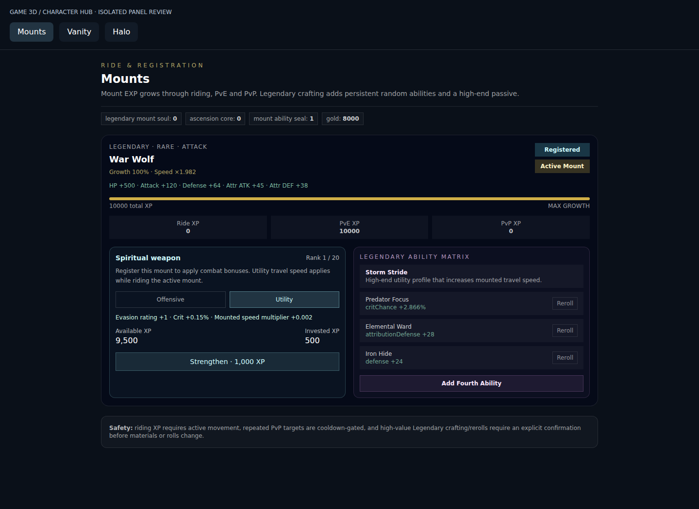
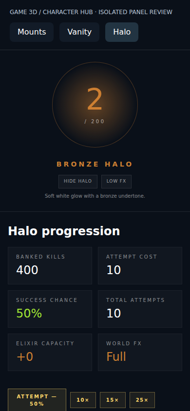

# GameView progression integration

The user's “Game 3D / Game Video” target is the existing `src/pages/GameView.jsx` route. This change extends its current `CharacterProgressionMenu` → Services → Mounts / Vanity / Halo panels. It does not add a Game5 screen to GameView or replace the GameWorld3D engine.

## Integration from the earlier work

Earlier work is preserved in draft PR #78 (`game5/systems-and-mmo-ui`). Its isolated rules and save schema are not interchangeable with the existing AXE runtime.

| Area | Applied to GameView | Preserved / remaining |
| --- | --- | --- |
| Spiritual weapon | Offensive/utility modes, earned-XP investment, rank preview, stat wiring, persistent mount state | Uses existing registered mount for combat bonuses and active mount for mounted speed. No visual weapon model is generated. |
| Mount progression | Lifetime/available/invested XP separated; cost review for legendary crafting, fourth ability, rerolls; finite XP validation | Existing growth bands, reward sources, mount definitions, legendary rules, registration and riding controls remain. |
| Player vanity | Card cost review, accurate action results, slot/ownership validation, empty-slot persistence | Existing four slots and locked +10% mapped-stat bonus remain. The earlier random-augment model is not substituted. |
| Halo | Batch cost review, cancel flow, persistent result feedback, responsive layout | Existing 200-level cap, real kill currency, success chances and visual controls remain. |
| Equipment / combat / inventory | Existing AXE systems stay in use | Earlier isolated Game5 engine, items, overcharge ceilings and saves are not imported into a different schema. |
| Mount vanity / absorption | Not migrated in this change | Requires a compatible AXE item/appearance binding and reward lifecycle; no fabricated art or unsupported asset attachment. |
| Backend transactions | No new live backend endpoints | These progression stores remain character-scoped browser storage. The earlier Game5 SQLite repository is not a production AXE authority and is not copied in as if it were. |

No existing save is reset. Old mount saves acquire a zero-rank offensive weapon on normalization. Vanity saves missing a slot map inherit starter defaults; an explicitly empty map remains empty. Existing valid legendary rolls are preserved.

## Spiritual weapon rules

`AXEMountSpiritualSystem.js` centralizes the provisional balance for playtesting:

- Rank cap 20 and next-rank XP cost `500 × nextRank`, carried from the earlier workbench.
- Cumulative invested XP is `500 × rank × (rank + 1) / 2`. Available XP is lifetime XP minus this amount. Investing never reduces growth or legendary crafting eligibility.
- Offensive: +8 flat damage per rank, through `getRegisteredAXEMountBonuses` → `playerHUDStore` → existing derived combat stats.
- Utility: +1 evasion rating and +0.15 percentage points critical chance per rank, through that same derived-stat path. These are an adaptation to AXE's actual stat vocabulary, not an assertion of final PvP balance.
- Utility mounted movement: +0.002 to the existing speed multiplier per rank through `getActiveAXEMountSpeedMultiplier`, read by GameWorld3D only while mounted. It does not increase unmounted movement speed.
- Mode switching is free, retains the purchased rank, and persists. Only the registered mount supplies combat bonuses; only the active mount supplies mounted speed.
- Rank purchase requires the current expected rank. Duplicate/stale confirmations fail without spending again. Cancel does not mutate progression. Switching characters clears pending UI reviews.

The earlier workbench's temporary absorption gate and universal mount-stat-share formula are not silently imposed on AXE's permanent registration system.

## Verification performed

- `node --test tests/game3d/progression-integration.test.mjs`: **12 passed**. Uses real AXE stores and the real player HUD; only the external Base44 service boundary is stubbed. Covers migration, single-spend, insufficient XP, stale confirmation, HUD damage/critical/evasion updates, mounted-speed output, rank limits, invalid XP, PvP reward cooldown, snapshot isolation, vanity removal/activation/ownership and character switching, halo kill spending/cap.
- `npm run build`: passed. Local build warned that `VITE_BASE44_APP_ID` and proxy base URL are absent; it does not establish live account/API functionality.
- `tools/game3d/review-progression.mjs`: passed Chromium checks at 1440×1050 and 390×844. Actual panels and stores are bundled into an isolated review harness with a test character. Checked mount upgrade/cancel/mode/legendary costs/reload, vanity activation/cancel/removal/reload, halo batch/cancel, all three mobile layouts, and clearing a pending review on account switch. No page errors.
- `git diff --check`: passed.

Browser review runner requires Playwright plus a Chromium installation. It accepts `PLAYWRIGHT_MODULE` for a local Playwright module and `CHROMIUM_PATH` for the executable. Those tools are not added to production dependencies. The runner creates test data only in its isolated localhost origin and stubs outbound Base44 writes.

## Manual review in the app

1. Open GameView with an existing character; open the C Character Hub and Services.
2. In Mounts, verify the same owned mounts and growth. Earn XP through the existing game rewards; review a spiritual upgrade, cancel, then confirm. Observe available XP decrease, lifetime growth remain, and Attributes update for the registered mount.
3. Switch spiritual mode and compare combat stats. Ride the active mount to assess movement feel; this needs live gameplay playtesting.
4. In Vanity, remove a piece, reload, and confirm the slot stays empty. Equip and empower using one card; verify the correct stat bonus and feedback. Hide/show should only change visibility.
5. In Halo, review a batch, cancel, then run it. Failed attempts still spend kills. Check the final result and unchanged level cap.
6. Switch characters with a review open; it must disappear and no old-character transaction should run.

## Limits and next integration work

This is source integration for review, not a deployment. It does not claim a fully migrated Game5 subsystem or production-secure multiplayer. Full live GameView/Character Hub behavior, companion attachment, actual riding and combat feel, PvP fairness, server authority, multi-device saves and offline reconciliation remain unverified. Existing controls, maps, character models and animations were not replaced. Further migration should adapt to the existing AXE equipment/economy/backend contracts instead of introducing a second inventory or combat simulator.
